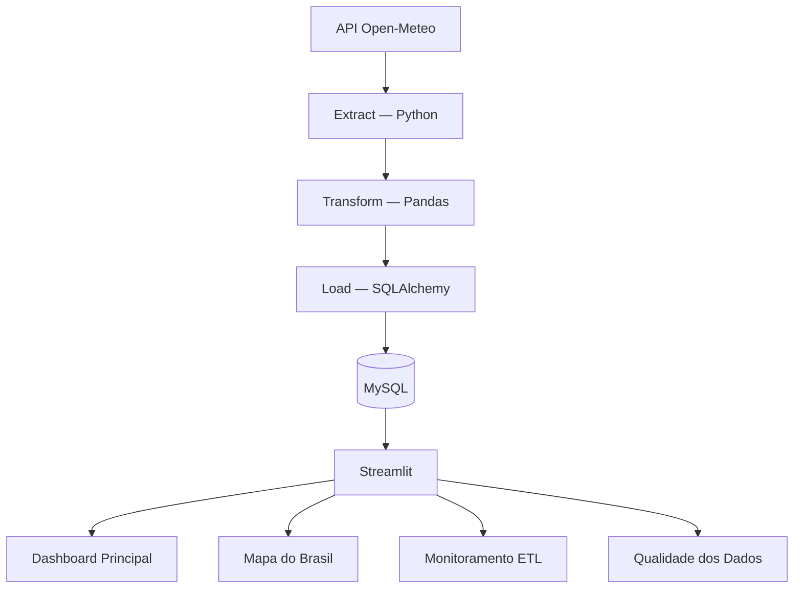

# 🌦️ Clima Brasil — Pipeline de Dados Meteorológicos

Projeto de Engenharia de Dados desenvolvido em Python para coletar, validar, transformar, armazenar e visualizar previsões meteorológicas de diferentes cidades brasileiras.

O sistema utiliza a API Open-Meteo como fonte de dados, MySQL para armazenamento e Streamlit para disponibilizar uma plataforma interativa de análise meteorológica.

Além do pipeline ETL, o projeto inclui histórico de previsões, monitoramento de execuções, verificações de qualidade, avisos meteorológicos baseados em critérios configuráveis e testes automatizados.

## 🎯 Objetivo

Construir uma solução de Engenharia de Dados que demonstre:

- Integração com APIs REST.
- Processamento e validação de dados com Python e Pandas.
- Persistência de dados em banco relacional.
- Histórico e rastreabilidade das coletas.
- Monitoramento da execução de pipelines.
- Controle de qualidade dos dados.
- Visualização e análise com dashboards interativos.
- Testes automatizados com Pytest.

O sistema trabalha com **previsões meteorológicas**, não com medições observadas em estações.

## 🛠️ Tecnologias

| Tecnologia | Utilização |
|---|---|
| Python | Desenvolvimento do pipeline |
| Pandas | Manipulação e transformação |
| NumPy | Validação de valores numéricos |
| Requests | Comunicação com a Open-Meteo |
| MySQL | Armazenamento das previsões |
| SQLAlchemy | Conexão e transações SQL |
| PyMySQL | Driver de acesso ao MySQL |
| Streamlit | Interface e dashboards |
| Plotly | Gráficos interativos |
| PyDeck | Mapa meteorológico |
| Pytest | Testes automatizados |
| Logging | Registro de eventos e erros |
| Python-dotenv | Variáveis de ambiente |

## 🌎 Cidades monitoradas

A configuração inicial contempla seis cidades:

| Cidade | UF |
|---|---|
| São Paulo | SP |
| Rio de Janeiro | RJ |
| Belo Horizonte | MG |
| Brasília | DF |
| Curitiba | PR |
| Recife | PE |

As localidades e suas coordenadas estão configuradas em `src/extract.py`.

Cada consulta solicita previsões diárias para sete dias, incluindo temperaturas máximas e mínimas, precipitação, umidade relativa, velocidade máxima do vento e condição meteorológica.

## 🚀 Funcionalidades

### 1. Pipeline ETL

O processamento está dividido em três etapas:

**Extract — Extração**

- Consulta à API Open-Meteo.
- Coleta de dados de múltiplas cidades.
- Validação da estrutura da resposta JSON.
- Tratamento de falhas de comunicação e timeout.

**Transform — Transformação**

- Conversão de datas e campos numéricos.
- Padronização de cidade e unidade federativa.
- Validação de temperaturas, chuva, umidade e vento.
- Exclusão de registros inconsistentes.
- Tratamento de valores ausentes.
- Remoção de duplicidades.

**Load — Carregamento**

- Gravação dos dados em MySQL.
- Atualização das previsões existentes.
- Preservação do histórico de cada coleta.
- Utilização de transações para consistência das gravações.

Cada cidade é processada individualmente. Uma falha em uma cidade não impede que as seguintes sejam processadas.

### 2. Dashboard principal

A página principal apresenta:

- Filtros por cidade e período.
- Indicadores meteorológicos.
- Comparação de temperaturas e precipitação.
- Gráficos de umidade e vento.
- Destaque das previsões.
- Tabela de dados e exportação em CSV.
- Evolução histórica das previsões.

### 3. Mapa meteorológico

Mapa interativo do Brasil desenvolvido com PyDeck.

Permite:

- Visualizar as cidades monitoradas.
- Selecionar a data da previsão.
- Consultar informações nos marcadores.
- Comparar indicadores meteorológicos.
- Identificar níveis internos de atenção.

### 4. Avisos meteorológicos

O dashboard identifica condições previstas acima de limites configuráveis:

| Indicador | Atenção | Elevado |
|---|---|---|
| Chuva diária | ≥ 20 mm | ≥ 50 mm |
| Temperatura máxima | ≥ 33 °C | ≥ 38 °C |
| Vento máximo | ≥ 40 km/h | ≥ 60 km/h |

**Importante:** os limites são critérios ilustrativos do projeto. Os avisos apresentados não representam alertas oficiais do INMET ou da Defesa Civil.

### 5. Histórico de previsões

O sistema preserva diferentes versões de uma previsão meteorológica.

Isso permite investigar como os valores previstos mudaram entre duas ou mais coletas.

O histórico possibilita analisar:

- Temperatura máxima e mínima.
- Precipitação prevista.
- Umidade relativa.
- Velocidade máxima do vento.
- Data e horário de cada coleta.

As versões históricas são armazenadas separadamente das previsões mais recentes.

### 6. Monitoramento do pipeline

O monitoramento registra:

- Início e fim da execução.
- Status: sucesso, parcial ou falha.
- Quantidade de cidades processadas.
- Registros gravados ou atualizados.
- Duração total da execução.
- Duração e resultado de cada cidade.
- Etapa em que ocorreu uma eventual falha.

Essas informações são exibidas em uma página específica do Streamlit.

### 7. Qualidade dos dados

O módulo de qualidade verifica:

- Existência das previsões esperadas.
- Cobertura da janela de sete dias.
- Atualização das coletas.
- Duplicidades.
- Valores ausentes ou inconsistentes.
- Temperaturas fora dos limites de validação.
- Precipitação, vento e umidade inválidos.

As cidades recebem os estados `OK`, `ATENÇÃO` ou `CRÍTICO`.

Os limites atuais de atualização são 36 horas para atenção e 72 horas para nível crítico. Esses valores podem ser ajustados no módulo de qualidade.

## 🏗️ Arquitetura



O MySQL armazena as previsões, o histórico de coletas e os registros de monitoramento. Os módulos Python também produzem logs durante o processamento.

Documentação adicional:

- [Arquitetura detalhada](docs/ARQUITETURA.md)
- [Modelo de dados MySQL](docs/BANCO_DE_DADOS.md)

## 📂 Estrutura do projeto

```text
pipeline-clima/
│
├── dashboard/
│   ├── pages/
│   │   ├── 1_Mapa_Meteorologico.py
│   │   ├── 2_Monitoramento.py
│   │   └── 3_Qualidade_Dados.py
│   ├── __init__.py
│   ├── app.py
│   ├── inicio.py
│   ├── components.py
│   └── style.css
│
├── src/
│   ├── __init__.py
│   ├── extract.py
│   ├── transform.py
│   ├── load.py
│   ├── monitoring.py
│   ├── quality.py
│   └── logging_config.py
│
├── sql/
│   └── schema.sql
│
├── tests/
│   ├── test_pipeline.py
│   └── test_qualidade.py
│
├── docs/
│   ├── ARQUITETURA.md
│   └── BANCO_DE_DADOS.md
│
├── logs/
│
├── main.py
├── requirements.txt
├── requirements-dev.txt
├── pytest.ini
├── .env.example
├── .gitignore
└── README.md
```

## ⚙️ Instalação e configuração

### Pré-requisitos

- Python compatível com as dependências do projeto.
- MySQL Server instalado e em execução.
- Acesso à internet para consultar a Open-Meteo.
- Git para clonar o repositório.

### 1. Obter o repositório

```bash
git clone https://github.com/luan-andrade07/pipeline-dados-meteorologicos.git
cd pipeline-dados-meteorologicos
```

### 2. Criar um ambiente virtual

```bash
python -m venv .venv
```

No Windows PowerShell:

```powershell
.\.venv\Scripts\Activate.ps1
```

### 3. Instalar dependências

```bash
python -m pip install -r requirements.txt
```

Para executar os testes:

```bash
python -m pip install -r requirements-dev.txt
```

### 4. Preparar o MySQL

Crie o banco de dados `projeto_dados` e execute o script:

```text
sql/schema.sql
```

Esse script prepara as tabelas principais de previsões e histórico.

As tabelas de monitoramento são criadas automaticamente pelo módulo `src/monitoring.py`, durante a primeira execução do pipeline, desde que o usuário do banco possua as permissões necessárias.

### 5. Configurar variáveis de ambiente

Crie um arquivo `.env` na raiz do projeto usando o `.env.example` como referência.

Exemplo:

```env
MYSQL_HOST=127.0.0.1
MYSQL_PORT=3306
MYSQL_DATABASE=projeto_dados
MYSQL_USER=root
MYSQL_PASSWORD=SUA_SENHA_MYSQL
```

Substitua os valores pelas configurações do seu ambiente.

**Segurança:** nunca publique o arquivo `.env` nem credenciais reais no GitHub. Para ambientes compartilhados, prefira um usuário MySQL específico com permissões adequadas.

### 6. Executar o pipeline ETL

Na raiz do projeto:

```bash
python main.py
```

A execução consulta as cidades configuradas, valida os dados, grava as previsões no MySQL e registra os resultados de monitoramento.

O código de saída será `0` quando todas as cidades forem processadas com sucesso e `1` quando ocorrer alguma falha.

### 7. Iniciar o dashboard

```bash
python -m streamlit run dashboard/inicio.py
```

Abra o endereço local exibido no terminal, normalmente:

```text
http://localhost:8501
```

O menu superior disponibiliza quatro páginas:

1. Painel Principal
2. Mapa do Brasil
3. Monitoramento ETL
4. Qualidade dos Dados

## 🗄️ Banco de dados

O projeto utiliza quatro tabelas:

| Tabela | Finalidade |
|---|---|
| `clima_diario` | Previsão mais recente por cidade e data |
| `clima_diario_historico` | Versões históricas das previsões |
| `pipeline_execucoes` | Resumo das execuções ETL |
| `pipeline_execucao_cidades` | Resultados individuais por cidade |

A tabela `clima_diario` utiliza uma chave única baseada em cidade, estado e data de referência.

A tabela histórica preserva as coletas realizadas, incluindo um horário de coleta em UTC.

Os dados históricos começam a ser acumulados a partir da ativação do respectivo módulo.

Consulte [BANCO_DE_DADOS.md](docs/BANCO_DE_DADOS.md) para os detalhes dos campos e consultas SQL.

## ✅ Testes automatizados

Os testes utilizam Pytest e dados simulados para verificar as principais regras do sistema, sem depender de chamadas reais à API ou de gravações no MySQL.

Estão incluídos cenários para:

- Validação das respostas da API.
- Tratamento de falhas de comunicação.
- Transformação e validação dos dados.
- Remoção de inconsistências e duplicidades.
- Preparação de registros SQL.
- Simulação da gravação do histórico.
- Classificação dos avisos meteorológicos.
- Qualidade, cobertura e atualização das previsões.

Execute:

```bash
python -m pytest -v
```

Em ambientes onde o cache do Pytest apresenta conflitos de acesso:

```bash
python -m pytest -v -p no:cacheprovider
```

**Resultado de validação:** 24 testes aprovados em 24/11/2026, no ambiente de desenvolvimento.

Os testes existentes são predominantemente unitários e não substituem testes de integração completos com um banco de dados isolado.

## 📝 Logs e monitoramento

Os eventos do pipeline são registrados pelo módulo `src/logging_config.py`.

Os logs incluem:

- Início e finalização do processamento.
- Quantidade de registros recebidos e validados.
- Erros de extração, transformação e carregamento.
- Resultados individuais por cidade.
- Informações de conclusão do pipeline.

O arquivo de log utilizado é:

```text
logs/pipeline.log
```

O logger utiliza rotação de arquivos para limitar seu crescimento.

Além dos logs, os resultados das execuções são armazenados nas tabelas de monitoramento do MySQL.

## 📊 Resultados validados

Na validação de 24/11/2026:

| Indicador | Resultado |
|---|---|
| Cidades configuradas | 6 |
| Previsões por coleta completa | 42 |
| Período solicitado à API | 7 dias |
| Testes automatizados | 24 aprovados |
| Duração de uma execução validada | 11,22 segundos |
| Cidades aprovadas na última análise de qualidade | 6 |

Os resultados representam o ambiente e a execução analisados. Os tempos de processamento e a disponibilidade dos dados podem variar.

## ⚠️ Limitações

- Os valores representam previsões, não observações meteorológicas reais.
- Os critérios de avisos não substituem alertas de órgãos oficiais.
- O banco MySQL precisa estar acessível para a execução do pipeline e do dashboard.
- As coordenadas das cidades são mantidas em uma configuração Python.
- O histórico não recupera versões anteriores à sua ativação.
- Os testes ainda não cobrem integralmente a interface Streamlit e a integração real com MySQL.
- A aplicação não possui uma implantação pública documentada nesta versão.

## 🔮 Possíveis evoluções

- Ampliar a cobertura para outras cidades brasileiras.
- Centralizar configurações e regras de validação.
- Criar testes de integração com banco isolado.
- Executar testes automaticamente por CI.
- Adicionar indicadores mais avançados de qualidade.
- Comparar previsões com dados meteorológicos observados.
- Aprimorar o design e a experiência de navegação.
- Publicar a aplicação em ambiente online.

## 🌐 Fonte meteorológica

Os dados são obtidos da [Open-Meteo Weather API](https://open-meteo.com/).

O projeto é independente e não representa um serviço meteorológico oficial.

---

**Projeto de Engenharia de Dados desenvolvido para aprendizado, experimentação e demonstração prática de habilidades em Python, SQL, APIs, processamento e visualização de dados.**
