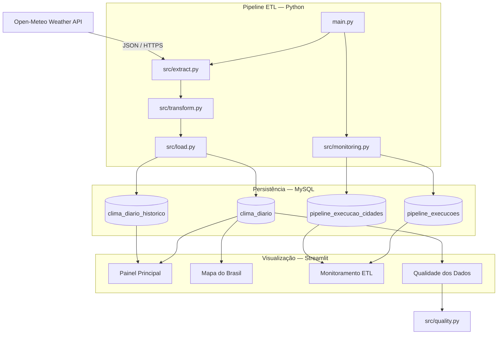
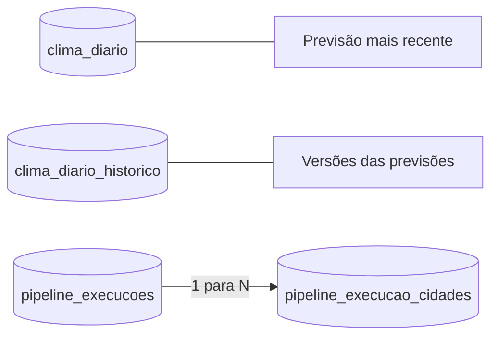

# Arquitetura do Pipeline de Dados Meteorológicos

## 1. Visão geral

O projeto implementa um pipeline ETL para previsões meteorológicas de seis cidades brasileiras.

A arquitetura está organizada em três responsabilidades:

1. **Ingestão e processamento:** coleta e validação dos dados meteorológicos.
2. **Persistência e observabilidade:** armazenamento das previsões, histórico e resultados das execuções.
3. **Apresentação e análise:** dashboards, mapa, monitoramento e qualidade dos dados.

A separação em módulos permite evoluir cada responsabilidade sem reconstruir todo o sistema.

## 2. Diagrama da arquitetura

O diagrama representa dependências funcionais; não significa que as consultas ao banco ocorram continuamente.

## 3. Fluxo de processamento

### 3.1 Inicialização

O arquivo `main.py` coordena a execução.

Ele carrega as configurações do ambiente, identifica as cidades cadastradas e inicia o monitoramento da execução.

### 3.2 Extração

**Módulo:** `src/extract.py`

Responsabilidades:

- Selecionar a cidade e suas coordenadas.
- Preparar os parâmetros da Open-Meteo.
- Enviar uma requisição HTTPS.
- Validar a estrutura da resposta JSON.
- Criar um DataFrame com os dados meteorológicos.
- Associar cidade e estado aos registros.

A API é consultada separadamente para cada cidade configurada.

### 3.3 Transformação

**Módulo:** `src/transform.py`

Responsabilidades:

- Verificar colunas obrigatórias.
- Padronizar campos textuais.
- Converter datas e valores numéricos.
- Identificar valores infinitos e inválidos.
- Validar temperaturas e demais indicadores.
- Remover registros inconsistentes.
- Remover duplicidades.
- Preparar os dados para persistência.

Os registros rejeitados são considerados no processo de validação e nos logs, mas não são gravados na tabela de previsões.

### 3.4 Carregamento

**Módulo:** `src/load.py`

A etapa de carregamento utiliza SQLAlchemy e PyMySQL para acessar o banco MySQL.

Duas operações são realizadas:

**Atualização da previsão atual**

A tabela `clima_diario` utiliza uma chave única por cidade, estado e data de referência. Quando essa combinação já existe, os valores são atualizados.

**Preservação do histórico**

Cada coleta também é registrada em `clima_diario_historico`, preservando a versão recebida e seu horário de coleta em UTC.

A atualização da tabela principal e a inserção histórica são realizadas em uma transação por cidade.

Isso evita que apenas uma das duas gravações seja confirmada em caso de erro transacional.

### 3.5 Monitoramento

**Módulo:** `src/monitoring.py`

O monitoramento registra:

- Horário inicial da execução.
- Horário final.
- Status da execução.
- Duração total.
- Quantidade de cidades processadas.
- Registros gravados ou atualizados.
- Resultado de cada cidade.
- Etapa em que ocorreu uma falha.

Os resultados ficam disponíveis para análise no dashboard.

### 3.6 Resultado da execução

O pipeline considera três resultados possíveis:

| Status | Significado |
|---|---|
| SUCESSO | Todas as cidades foram processadas |
| PARCIAL | Algumas cidades foram processadas e outras falharam |
| FALHA | Nenhuma cidade foi processada com sucesso |

Uma falha em uma cidade não impede a tentativa de processamento das próximas cidades.

As cidades são gravadas individualmente, portanto o projeto não utiliza uma única transação para toda a execução.

## 4. Camada de apresentação

A interface utiliza Streamlit.

O arquivo `dashboard/inicio.py` define a navegação entre as páginas.

### 4.1 Painel Principal

**Arquivo:** `dashboard/app.py`

Apresenta as previsões, indicadores, gráficos, alertas e histórico de diferentes coletas.

### 4.2 Mapa do Brasil

**Arquivo:** `dashboard/pages/1_Mapa_Meteorologico.py`

Utiliza PyDeck para posicionar as cidades no mapa a partir de suas coordenadas cadastradas.

As cores dos marcadores indicam níveis internos de atenção.

### 4.3 Monitoramento ETL

**Arquivo:** `dashboard/pages/2_Monitoramento.py`

Consulta as tabelas de monitoramento e apresenta resultados, duração das execuções e desempenho por cidade.

### 4.4 Qualidade dos Dados

**Arquivo:** `dashboard/pages/3_Qualidade_Dados.py`

Consulta os dados meteorológicos e utiliza `src/quality.py` para verificar cobertura, atualização e consistência.

A análise é executada na camada de apresentação. Ela não modifica os registros do MySQL.

## 5. Modelo de persistência

O banco utiliza quatro tabelas:

As tabelas `clima_diario` e `clima_diario_historico` representam visões diferentes das previsões.

Elas não possuem chave estrangeira entre si no modelo atual.

A relação formal de chave estrangeira ocorre entre `pipeline_execucoes` e `pipeline_execucao_cidades`.

Detalhes disponíveis em [BANCO_DE_DADOS.md](BANCO_DE_DADOS.md).

## 6. Política de horários

O projeto utiliza duas informações diferentes de data:

**Data de referência**

A data para a qual a previsão meteorológica se aplica.

**Data de coleta**

O momento em que a previsão foi recebida e armazenada.

A tabela histórica e as tabelas de monitoramento utilizam colunas `DATETIME` com convenção explícita de UTC.

As interfaces convertem esses horários para `America/Sao_Paulo` quando necessário.

A coluna `data_coleta` da tabela principal utiliza o tipo `TIMESTAMP` do MySQL, sujeito à conversão de fuso da sessão do banco.

## 7. Controle de qualidade

O módulo `src/quality.py` implementa verificações independentes da extração.

Entre as regras avaliadas estão:

- Cobertura das datas esperadas.
- Campos ausentes.
- Duplicidades.
- Temperaturas inconsistentes.
- Valores numéricos inválidos.
- Atualização das coletas.

O resultado é dividido em resumo por cidade e ocorrências detalhadas.

O controle de qualidade verifica a integridade dos dados armazenados, mas não comprova a precisão de uma previsão meteorológica.

## 8. Logs e observabilidade

O projeto utiliza o módulo `logging` do Python.

O arquivo `src/logging_config.py` configura os registros de execução e a rotação dos arquivos de log.

O monitoramento em MySQL complementa os logs ao disponibilizar dados estruturados sobre o desempenho das execuções.

## 9. Testabilidade

A separação entre módulos permite testar as regras de extração, transformação e qualidade sem uma conexão real com MySQL ou Open-Meteo.

Os testes utilizam:

- Pytest.
- DataFrames simulados.
- Respostas HTTP simuladas.
- Objetos simulados de conexão com banco.

A suíte validada em 24/11/2026 contém 24 casos de teste.

Essa cobertura não substitui testes de integração reais nem testes completos da interface.

## 10. Segurança

As credenciais do banco são carregadas a partir de variáveis de ambiente.

O arquivo `.env` deve permanecer fora do controle de versão.

Boas práticas recomendadas:

- Não publicar credenciais.
- Utilizar contas específicas para acesso ao banco.
- Conceder apenas as permissões necessárias.
- Fazer backup periódico dos dados importantes.
- Evitar publicar informações sensíveis nos logs.

## 11. Limitações atuais

- A lista de cidades é configurada no código Python.
- O pipeline consulta previsões, não dados observados.
- Os limites meteorológicos de aviso são internos.
- O histórico começa quando a funcionalidade é ativada.
- Não há retenção automática de dados históricos implementada.
- O ambiente MySQL precisa estar disponível para consultas e gravações.
- Não existe uma avaliação contínua da precisão das previsões contra observações reais.

## 12. Melhorias futuras

- Centralizar o cadastro de cidades.
- Criar testes de integração com MySQL isolado.
- Adicionar métricas mais avançadas de qualidade.
- Implementar controle de retenção do histórico.
- Comparar previsões e observações meteorológicas.
- Publicar o dashboard em ambiente online.
- Padronizar a identidade visual da plataforma.
