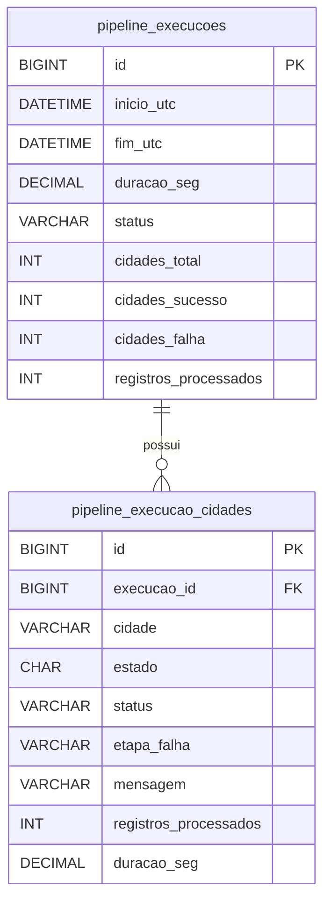

# Documentação do Banco de Dados MySQL

## 1. Visão geral

O projeto utiliza o banco relacional MySQL para armazenar previsões meteorológicas, preservar versões históricas e registrar resultados das execuções do pipeline ETL.

Banco utilizado:

```text
projeto_dados
```

O modelo possui quatro tabelas principais:

| Tabela | Responsabilidade |
|---|---|
| clima_diario | Previsão mais recente |
| clima_diario_historico | Histórico das coletas |
| pipeline_execucoes | Execuções do pipeline |
| pipeline_execucao_cidades | Processamento individual por cidade |

## 2. Tabela clima_diario

Armazena a versão mais recente de cada previsão.

### Principais campos

| Campo | Tipo | Descrição |
|---|---|---|
| id | INT | Identificador |
| cidade | VARCHAR(100) | Nome da cidade |
| estado | CHAR(2) | Unidade federativa |
| data_referencia | DATE | Data da previsão |
| temperatura_max_c | DECIMAL(5,2) | Temperatura máxima |
| temperatura_min_c | DECIMAL(5,2) | Temperatura mínima |
| precipitacao_mm | DECIMAL(7,2) | Precipitação prevista |
| umidade_media_pct | DECIMAL(5,2) | Umidade relativa média |
| vento_max_kmh | DECIMAL(7,2) | Vento máximo |
| codigo_clima | INT | Código meteorológico WMO |
| data_coleta | TIMESTAMP | Atualização do registro |

A chave única é composta por:

```text
(cidade, estado, data_referencia)
```

O carregamento utiliza `INSERT ... ON DUPLICATE KEY UPDATE`.

Isso permite atualizar a previsão da mesma cidade e data sem criar registros duplicados na tabela principal.

## 3. Tabela clima_diario_historico

Preserva versões sucessivas das previsões.

Contém os mesmos campos meteorológicos da tabela principal, além de:

| Campo | Tipo | Descrição |
|---|---|---|
| id | BIGINT | Identificador histórico |
| data_coleta_utc | DATETIME(6) | Momento da coleta em UTC |

Nessa tabela, diferentes coletas podem registrar valores distintos para a mesma cidade e data de referência.

Exemplo conceitual:

| Cidade | Previsão para | Coleta | Chuva prevista |
|---|---|---|---|
| São Paulo | 25/11 | 23/11 às 15h | 6 mm |
| São Paulo | 25/11 | 23/11 às 20h | 18 mm |

Os dados acima são ilustrativos.

O histórico permite avaliar a evolução de uma previsão, mas não comprova qual previsão foi mais precisa.

## 4. Tabela pipeline_execucoes

Armazena o resumo de cada execução do pipeline.

| Campo | Descrição |
|---|---|
| id | Identificador da execução |
| inicio_utc | Horário de início |
| fim_utc | Horário de conclusão |
| duracao_seg | Duração em segundos |
| status | Resultado da execução |
| cidades_total | Quantidade configurada |
| cidades_sucesso | Cidades processadas |
| cidades_falha | Cidades com falha |
| registros_processados | Registros gravados ou atualizados |

### Estados utilizados

- `EM_EXECUCAO`: execução iniciada, ainda sem conclusão registrada.
- `SUCESSO`: todas as cidades concluídas.
- `PARCIAL`: parte das cidades concluída.
- `FALHA`: nenhuma cidade concluída com sucesso.

Uma execução interrompida inesperadamente pode permanecer com o estado `EM_EXECUCAO`, exigindo investigação dos logs.

## 5. Tabela pipeline_execucao_cidades

Armazena o resultado individual de cada cidade.

| Campo | Descrição |
|---|---|
| id | Identificador do registro |
| execucao_id | Execução associada |
| cidade | Cidade processada |
| estado | Unidade federativa |
| status | Sucesso ou falha |
| etapa_falha | Etapa em que ocorreu uma falha |
| mensagem | Detalhe do problema |
| registros_processados | Quantidade gravada |
| duracao_seg | Tempo de processamento |

A coluna `execucao_id` é uma chave estrangeira para `pipeline_execucoes.id`.

## 6. Relacionamento entre execuções



Uma execução pode possuir vários registros de processamento por cidade.

## 7. Consultas SQL úteis

As consultas seguintes são apenas de leitura.

### 7.1 Quantidade de previsões por cidade

```sql
SELECT
    cidade,
    estado,
    COUNT(*) AS total_previsoes
FROM clima_diario
GROUP BY cidade, estado
ORDER BY cidade;
```

### 7.2 Cobertura dos próximos sete dias

```sql
SELECT
    cidade,
    estado,
    COUNT(DISTINCT data_referencia) AS dias_disponiveis
FROM clima_diario
WHERE
    data_referencia >= CURDATE()
    AND data_referencia <
        DATE_ADD(CURDATE(), INTERVAL 7 DAY)
GROUP BY cidade, estado
ORDER BY cidade;
```

Essa consulta utiliza a data da sessão MySQL. A análise Python de qualidade utiliza o horário de São Paulo para determinar a data atual.

### 7.3 Histórico de uma previsão

```sql
SELECT
    cidade,
    estado,
    data_referencia,
    temperatura_max_c,
    temperatura_min_c,
    precipitacao_mm,
    data_coleta_utc
FROM clima_diario_historico
WHERE
    cidade = 'São Paulo'
    AND estado = 'SP'
    AND data_referencia = CURDATE()
ORDER BY data_coleta_utc;
```

Permite observar como a previsão de uma data mudou entre coletas.

### 7.4 Últimas execuções do pipeline

```sql
SELECT
    id,
    inicio_utc,
    fim_utc,
    status,
    duracao_seg,
    cidades_sucesso,
    cidades_falha,
    registros_processados
FROM pipeline_execucoes
ORDER BY id DESC
LIMIT 10;
```

### 7.5 Resultado detalhado da última execução

```sql
SELECT
    c.cidade,
    c.estado,
    c.status,
    c.etapa_falha,
    c.mensagem,
    c.registros_processados,
    c.duracao_seg
FROM pipeline_execucao_cidades AS c
WHERE c.execucao_id = (
    SELECT MAX(id)
    FROM pipeline_execucoes
)
ORDER BY c.cidade;
```

### 7.6 Quantidade total de registros históricos

```sql
SELECT
    COUNT(*) AS total_registros_historicos
FROM clima_diario_historico;
```

## 8. Estratégia de persistência

O carregamento executa duas operações para cada cidade:

1. Atualiza as previsões em `clima_diario`.
2. Acrescenta versões em `clima_diario_historico`.

As duas operações são executadas na mesma transação de dados.

Entretanto, cidades diferentes são processadas em transações independentes.

Se uma cidade falhar, as gravações anteriores de outras cidades podem permanecer válidas.

## 9. Atualização e rastreabilidade

A tabela principal é voltada para consultas das previsões mais recentes.

A tabela histórica é voltada para análise temporal, auditoria e comparação entre versões.

As tabelas de monitoramento permitem investigar o desempenho e os resultados das execuções ETL.

O histórico não recupera versões de previsões anteriores à implantação da funcionalidade.

## 10. Considerações técnicas

- O banco utiliza MySQL com tabelas InnoDB.
- O projeto utiliza SQLAlchemy para executar comandos SQL.
- Os horários históricos são armazenados como UTC em campos DATETIME.
- DATETIME não armazena a informação de fuso horário.
- A coluna TIMESTAMP da tabela principal está sujeita às regras de fuso da sessão MySQL.
- Não existe uma política automática de retenção do histórico implementada.
- As tabelas de monitoramento são criadas pelo módulo Python quando necessário.
- As consultas do dashboard dependem da disponibilidade do MySQL.

## 11. Possíveis melhorias

- Criar migrações versionadas do banco.
- Definir políticas de retenção do histórico.
- Melhorar os índices conforme o volume de consultas.
- Adicionar testes de integração SQL.
- Implementar backup e restauração documentados.
- Criar visões analíticas para relatórios.
